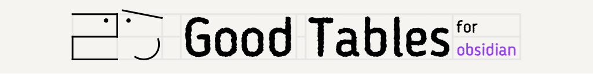
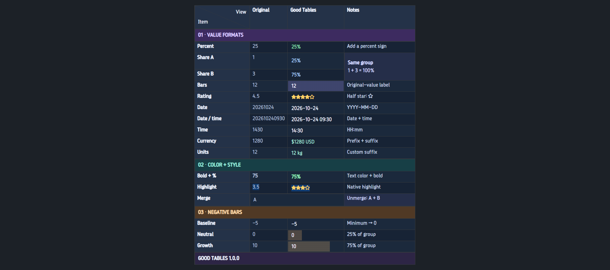

# Good Tables

**옵시디언 표를 더 보기 좋게.**

    

[설치하기](#-설치) · [주요 기능](#-표에-표현을-더하세요) · [English](README.md) · [변경 기록](CHANGELOG.md) · [문제 제보](https://github.com/MEKBANSUKOZINGER/Good-Tables/issues)

기존 표와 새 Markdown 표에 **색상·별점·계산 막대·날짜·병합·대각선 제목**을 더하세요. 익숙한 옵시디언 기본 표 편집기에서 선택·행과 열 이동·실행 취소를 그대로 사용합니다.

---

## ✨ 표에 표현을 더하세요

| 기능                 | 할 수 있는 일                                                              |
| -------------------- | -------------------------------------------------------------------------- |
| **빠른 표 생성**     | 명령 팔레트·리본·사용자 단축키로 행과 열 수를 정해 표를 만듭니다.          |
| **값 서식**          | 비율·계산 비율·가로 막대·날짜·시각·별점·접두사와 접미사로 값을 표시합니다. |
| **색상과 제목**      | 제목 행·열과 칸 색상을 지정하고 자주 쓰는 색을 6개까지 저장합니다.         |
| **병합과 대각선**    | 원본 값을 보존하며 직사각형을 병합하거나 첫 칸의 양쪽에 직접 입력합니다.   |
| **기본 편집**        | 원본 값을 수정하고 서식과 함께 행·열을 옮기며 실행 취소·재실행합니다.      |
| **나에게 맞는 설정** | 자주 쓰는 서식의 순서와 표시 기본값을 바꾸고 영어·한국어를 선택합니다.     |

## ⚡ 행과 열 수만 정하면 표 완성

Markdown 문법을 직접 입력하지 않고 기본 표를 만드세요. 전체 행·열 수를 정하고 첫 칸 대각선을 선택하면 현재 커서 위치에 표가 들어갑니다.

1. 편집 가능한 노트에서 표를 넣을 위치에 커서를 놓으세요.
2. 명령 팔레트에서 **Good Tables: 표 만들기**를 실행하거나 왼쪽 리본의 **표 아이콘**을 누르세요.
3. **행**과 **열** 수를 정하고, 필요하면 **첫 칸 대각선**을 켜세요.
4. **적용**을 누르고 내용을 입력하세요.

행·열 수는 표 전체 크기입니다. **3행 × 4열이면 총 12칸**이 생성됩니다. 제목 행이나 열은 자동으로 지정하지 않으며, 필요할 때 직접 설정합니다.

첫 행도 제목 행·열에 속하거나 직접 굵게 서식을 적용한 칸만 굵게 표시합니다. 행이나 열을 추가해도 기존 제목 지정은 유지됩니다.

더 빠르게 실행하려면 옵시디언 **단축키** 설정에서 **Good Tables: 표 만들기**에 원하는 키를 지정하세요.

## 🖍️ 기본 서식 메뉴에서 바로

칸을 선택하고 우클릭한 뒤 옵시디언의 **서식** 메뉴를 여세요. Good Tables 서식은 **코드·수식·주석 다음, 서식 지우기 앞**에 표시됩니다.

- 적용 가능한 서식을 모두 표시하고, 현재 서식에는 체크가 나타납니다.
- 다른 서식을 선택하면 교체하고 같은 서식을 다시 선택하면 해제합니다.
- 일부에만 서식이 있거나 서로 다른 서식이 섞인 범위도 한 번에 바꿉니다.
- 자주 쓰는 접두사·접미사 서식을 등록하고 메뉴 순서를 정하세요. 일반 **사용자 지정**은 Good Tables 서식 목록의 맨 아래에 유지됩니다.
- **서식 지우기**로 값 서식과 개별 색상을 함께 지우세요. 병합·대각선·제목 지정·칸 크기는 유지됩니다.

### 이렇게 표시됩니다

| 서식               | 원본 값               | 표시               |
| ------------------ | --------------------- | ------------------ |
| 비율               | `25`                  | `25%`              |
| 계산 비율          | 같은 그룹의 `1`과 `3` | `25%`, `75%`       |
| 별점               | `4.5`                 | `★★★★☆`            |
| 날짜               | `20261024`            | `2026-10-24`       |
| 날짜와 시각        | `202610241430`        | `2026-10-24 14:30` |
| 시각               | `1430`                | `14:30`            |
| 사용자 지정 접미사 | `12`                  | `12 kg`            |

기본 표시 설정을 기준으로 한 예시입니다. 가로 막대는 같은 그룹에서 각 값이 차지하는 비율을 나타내며, 원본 숫자나 비율을 표시하도록 선택할 수 있습니다.

**굵게·기울임·취소선·하이라이트는 값 서식과 함께 사용**할 수 있으며 기본 하이라이트의 여섯 색도 지원합니다. **코드·주석·수식**을 적용하면 해당 칸의 Good Tables 값 서식이 해제되고, 기본 실행 취소·재실행으로 두 상태를 함께 복원합니다.

## 🧩 병합해도 원본 값은 그대로

직사각형 범위를 병합해 공통 제목이나 긴 메모를 표시하세요. 가장 왼쪽 위 칸의 내용이 보이고 나머지 값은 Markdown 표에 보관됩니다. **병합 취소**를 누르면 다시 드러납니다.

병합 칸은 내용에 맞춰 줄바꿈하고, 내용을 수정하거나 열 너비를 바꾸면 높이가 자동으로 늘어나거나 줄어듭니다.

병합 칸을 더블클릭하거나 **원본 값 편집**으로 기준 칸을 수정할 수 있습니다. 제목 영역과 일반 영역을 가로지르는 병합은 지원하지 않습니다.

## ◩ 대각선 칸에 직접 입력

**첫 칸 대각선**을 켜고 **왼쪽 아래·오른쪽 위** 입력란에 바로 입력하세요. 여러 줄과 한글 조합 입력을 지원합니다.

대각선을 끄면 아래쪽 값과 위쪽 값이 추가 공백 없이 연결됩니다.

## 🎨 색을 보면서 고르세요

채도·밝기 영역과 색조 막대에서 고르거나 **HEX·RGB**를 직접 입력하세요. 현재 색과 선택한 색을 비교하고, 문서에서 사용한 색을 다시 쓰거나 **배경·글자가 공유하는 자주 쓰는 색 6개**를 저장할 수 있습니다.

- 제목 칸에도 개별 배경색·글자색을 지정합니다.
- 직접 지정한 글자색은 스킨의 굵게·기울임·하이라이트 색보다 우선하며, 해제하면 스킨 색으로 돌아갑니다.
- 가로 막대의 기본 색이나 개별 색을 선택할 수 있고 모든 막대는 **25% 반투명**을 유지합니다.
- 표시 설정을 바꾸면 기존 표도 즉시 바뀝니다.

## 🚀 설치

**옵시디언 데스크톱 1.14.4 이상**이 필요합니다.

### 커뮤니티 플러그인에서

1. 옵시디언에서 **설정 → 커뮤니티 플러그인 → 탐색**을 여세요.
2. **Good Tables**를 검색하고 설치한 뒤 활성화하세요.

[플러그인 목록 열기](https://obsidian.md/plugins?id=good-tables)

### 수동 설치

1. [GitHub Releases](https://github.com/MEKBANSUKOZINGER/Good-Tables/releases)에서 **main.js·manifest.json·styles.css**를 받습니다.
2. 세 파일을 볼트의 `.obsidian/plugins/good-tables/`에 넣습니다.
3. 옵시디언을 다시 불러오고 **설정 → 커뮤니티 플러그인**에서 **Good Tables**를 켭니다.

설치용 `good-tables-1.0.1.zip`에는 같은 세 파일이 `good-tables/` 폴더에 들어 있습니다. 이 폴더를 `.obsidian/plugins/`에 풀어도 됩니다. GitHub가 자동 생성하는 소스 압축 파일은 먼저 빌드해야 합니다.

### 첫 표 만들기

1. 명령 팔레트에서 **Good Tables: 표 만들기**를 실행하거나 리본의 표 아이콘을 누르세요. 기존 Markdown 표를 사용해도 됩니다.
2. 전체 행·열 수와 첫 칸 대각선 여부를 정합니다. 제목 행·열은 직접 지정합니다.
3. 한 칸·직사각형 범위·행·열을 선택하고 우클릭해 서식을 적용하세요.

옵시디언 단축키 설정에서 **표 만들기**에 원하는 키를 지정할 수 있습니다. 자동으로 할당되는 단축키는 없습니다.

## 💬 알아두면 좋아요

<strong>Markdown 원본과 플러그인을 껐을 때의 표는 어떻게 되나요?</strong>

내용은 일반 Markdown 표에 유지하며 병합에 가려진 원본도 남깁니다. 표시 정보는 표 바로 다음에 `[good-tables-…]: good-tables:…` 형식의 사용하지 않는 참조 정의로 저장합니다.

Markdown 표를 복사하거나 옮길 때에는 이 참조 정의도 함께 옮기세요. 읽기 보기에는 나타나지 않고, Good Tables가 라이브 프리뷰에서도 숨깁니다. 소스 모드에서는 전체를 확인할 수 있습니다.

플러그인을 끄면 확장 표시가 사라지고 일반 표와 원본 값이 남습니다. 최초 사용 안내와 비활성화 알림을 제공합니다.

<strong>기본 편집과 행·열 이동은 유지되나요?</strong>

기본 셀 편집·Tab 이동·행과 열 선택기·클립보드·문서 실행 취소를 사용합니다. 별도 번호 선택기나 추가 크기 조절 핸들을 만들지 않습니다. 실행할 수 있는 메뉴만 나타나며 Good Tables 표시가 없는 일반 선택에서는 원본 값 복사·편집을 숨깁니다.

행·열 이동에 서식과 제목 지정도 따라갑니다. 이동으로 병합이 직사각형을 이루지 못하면 해당 병합만 취소하고 원본을 유지합니다. 대각선 칸이 첫 모서리에서 벗어나면 대각선 표시를 해제하고 연결된 텍스트를 유지합니다.

외부 구조 변경으로 기존 칸을 안전하게 대응할 수 없으면 정보를 보존한 채 적용을 멈춥니다. 구조 변경을 실행 취소하거나 **이 표의 Good Tables 정보 초기화**를 사용하세요. 초기화도 실행 취소할 수 있습니다.

Fileclass 노트 속성·스키마 명령은 표 안에서만 숨기고 일반 노트 편집기에는 유지합니다. 설정 변경은 기존 표에 바로 반영되며 문서 실행 취소와 별도로 처리됩니다.

<strong>숫자·날짜·막대·별점은 어떤 규칙으로 읽나요?</strong>

- 숫자 서식은 부호가 있는 일반 정수·소수를 읽습니다. 쉼표·단위·퍼센트·지수 표기·무한대 등은 읽지 않습니다.
- 계산 비율은 기본적으로 제목·빈 칸·잘못된 값·병합에서 가려진 칸을 합계에서 제외합니다. 비율에 음수를 적용할 수 없고, 적용 후 음수로 고치면 수정할 때까지 `(!NUM)`을 표시합니다.
- 막대에 음수가 있으면 최솟값을 0으로 옮겨 비율을 계산합니다. 합계가 0이면 길이도 0입니다. 기본 라벨은 원본 숫자입니다.
- 날짜·날짜와 시각·시각은 각각 8·12·4자리 숫자를 읽고 실제 달력상의 날짜 검사는 하지 않습니다. 표시 패턴은 변경할 수 있습니다.
- 빈 별 `☆`는 0.5점을 나타냅니다. 별점은 정확한 0.5 단위를 유지하고 나머지 소수는 정수로 반올림하며 설정한 최댓값을 적용합니다. 10을 넘으면 반올림한 정수로 `★ X N`을 표시합니다.

<strong>모바일·언어·개인정보는 어떻게 지원하나요?</strong>

데스크톱 전용입니다. 옵시디언의 영어·한국어 설정을 자동으로 따르거나 수동으로 언어를 선택할 수 있으며, 다른 언어에서는 영어로 표시됩니다.

플러그인은 로컬에서 동작하며 네트워크 요청이나 사용 정보 전송을 하지 않습니다. 표는 옵시디언 편집기로 저장하고 설정은 플러그인 데이터 API로 저장합니다.

**클립보드 사용:** **원본 값 복사**는 선택한 칸을 탭으로 구분해 시스템 클립보드에 씁니다. 붙여넣기 창과 여러 셀 붙여넣기는 사용자가 제공한 탭·줄바꿈을 열·행으로 해석합니다. 백그라운드에서 클립보드를 읽지 않으며 옵시디언 전용 표 클립보드 데이터는 기본 처리에 맡깁니다.

---

## 🛠️ 개발과 피드백

빌드·로컬 설치·실제 앱 QA·배포 확인은 [개발 문서](docs/DEVELOPMENT.md)를 참고하세요.

문제가 있다면 옵시디언과 Good Tables 버전, 편집·읽기 보기, 스킨 이름, 작은 예시 표와 재현 방법을 적어 [이슈를 열어주세요](https://github.com/MEKBANSUKOZINGER/Good-Tables/issues). 필요하면 화면도 함께 첨부해주세요.

[MIT 라이선스](LICENSE) · Copyright © 2026 MEKBANSUKOZINGER.
