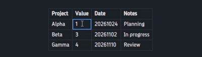
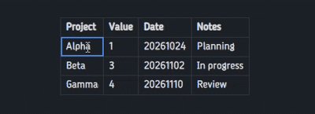
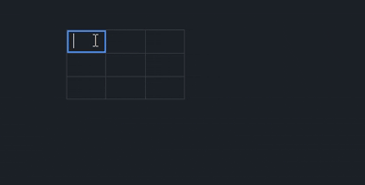
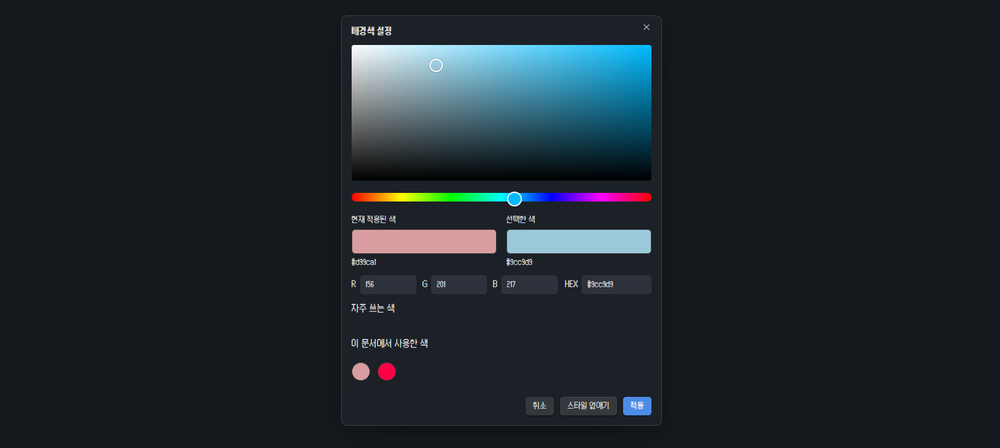

# Good Tables

**Make your Obsidian tables easier to read.**

[Get started](#-installation) · [See the features](#-features-at-a-glance) · [한국어](README.ko.md) · [Changelog](CHANGELOG.md) · [Report an issue](https://github.com/MEKBANSUKOZINGER/Good-Tables/issues)

Give existing and new Markdown tables **colors, ratings, calculated bars, dates, merged cells, and diagonal headings**. Work in Obsidian's native table editor, with familiar selection, row/column handles, and undo/redo.

---

## ✨ Features at a glance

| Feature                  | What you can do                                                                                      |
| ------------------------ | ---------------------------------------------------------------------------------------------------- |
| **Value formats**        | Show percentages, calculated shares, bars, dates, times, stars, and custom prefixes or suffixes.     |
| **Color and titles**     | Mark title rows or columns, choose cell colors, and save six favorite colors.                        |
| **Merges and diagonals** | Merge rectangular ranges while retaining their contents, or type into both halves of the first cell. |
| **Native editing**       | Edit original values, move rows and columns with their styles, and use Obsidian's history.           |
| **Your preferences**     | Reorder saved formats, change display defaults, and use English or Korean.                           |

## 🖍️ Format values from the native menu

Select cells, right-click, and open Obsidian's **Format** submenu. Good Tables formats appear after **Code / Math / Comment** and before **Clear formatting**.

- Every applicable format stays available. The active format has a checkmark.
- Choose another format to replace it; choose the same format again to remove it.
- Change a mixed or partially formatted range in one action.
- Save your own prefix/suffix formats and give each one a place in the menu. The general **Custom** entry stays last among Good Tables formats.

<!-- #2: Replace the placeholder below with  -->

[#2 here]

### A few examples

| Format           | Original value                | Display            |
| ---------------- | ----------------------------- | ------------------ |
| Percentage       | `25`                          | `25%`              |
| Calculated share | `1` and `3` in the same group | `25%` and `75%`    |
| Rating           | `4.5`                         | `★★★★☆`            |
| Date             | `20261024`                    | `2026-10-24`       |
| Date and time    | `202610241430`                | `2026-10-24 14:30` |
| Time             | `1430`                        | `14:30`            |
| Custom suffix    | `12`                          | `12 kg`            |

Examples use the default display settings. Bars show each value's share of its group; their label can show the original number or its percentage.

**Bold, italic, strikethrough, and highlight work alongside value formats**, including all six native highlight colors. Applying **Code, Comment, or Math** removes the Good Tables value format from those cells. Native undo/redo restores both states.

## 🧩 Merge, then bring every cell back

Merge a rectangular selection to make a shared label or a longer note. The top-left cell supplies the visible content; the other values stay in the Markdown table. **Unmerge** reveals them again.

Merged cells wrap their content and automatically grow or shrink in height as you edit or resize columns.

Double-click a merged cell, or choose **Edit original values**, to edit its anchor. Merges cannot cross the boundary between title and ordinary cells.

<!-- #3: Replace the placeholder below with  -->

[#3 here]

## ◩ Type directly into a diagonal heading

Turn on **Diagonal first cell** and type into the **lower-left** and **upper-right** fields in place. Both support multiple lines and IME composition.

Turning the diagonal off joins the lower and upper values without an added space.

<!-- #4: Replace the placeholder below with  -->

[#4 here]

## 🎨 Choose colors you can see

Use a visible saturation/brightness surface and hue strip, synchronized with **HEX and RGB**. Compare the current and selected colors, reuse colors from the document, or keep up to **six shared favorites** for backgrounds and text.

- Title cells support individual background and text colors.
- Explicit text colors take priority over a theme's bold, italic, or highlight colors. Clear a color to restore the theme's styling.
- Choose a default bar color or change it for selected bar cells. Every bar color retains **25% opacity**.
- Existing tables update when you change the display settings.

<!-- #5: Replace the placeholder below with  -->

[#5 here]

## 🚀 Installation

**Obsidian Desktop 1.14.4 or later** is required.

### Community plugins

1. Open **Settings → Community plugins → Browse** in Obsidian.
2. Search for **Good Tables**, then choose **Install** and **Enable**.

[Open the plugin listing](https://obsidian.md/plugins?id=good-tables)

### Manual installation

1. Open [GitHub Releases](https://github.com/MEKBANSUKOZINGER/Good-Tables/releases) and download **main.js**, **manifest.json**, and **styles.css**.
2. Put all three files in your vault's `.obsidian/plugins/good-tables/` folder.
3. Reload Obsidian and enable **Good Tables** in **Settings → Community plugins**.

The optional `good-tables-1.0.0.zip` contains the same three files inside a `good-tables/` folder. Extract that folder into `.obsidian/plugins/`. GitHub's automatic source archives require building first.

### Your first table

1. Run **Good Tables: Create table** from the command palette or click the table ribbon icon. You can also start with an existing Markdown table.
2. Set the total row and column counts and, optionally, a diagonal first cell. Title rows and columns are assigned manually.
3. Select a cell, rectangular range, row, or column, then right-click to format it.

Assign a shortcut to **Create table** in Obsidian's Hotkeys settings. No shortcut is assigned automatically.

## 💬 Good to know

<strong>What happens to the Markdown or when I disable the plugin?</strong>

Cell contents remain in an ordinary Markdown table, including the hidden values under merges. Presentation metadata is stored immediately after it as unused Markdown reference definitions beginning with `[good-tables-` and a `good-tables:` destination.

Keep that reference block with its table when copying or moving the Markdown. Reading view hides it; Good Tables also hides it in Live Preview. Source mode shows the full source.

Disabling the plugin removes its presentation and leaves the ordinary table and its raw values. A first-use dialog and an unload notice explain the display change.

<strong>Which editing and selection behaviors are supported?</strong>

Use native cell editing, Tab navigation, row/column handles, clipboard actions, and document undo/redo. Good Tables adds no numbered selectors or extra resize handles. Only applicable actions appear; original-value copy/edit commands are hidden for plain selections with no Good Tables presentation.

Row/column moves carry formatting and title assignments. If a move breaks a merged rectangle, only that merge is undone and its original cells remain. Moving the diagonal cell away from the first corner ends its diagonal display and retains the joined text.

If an ambiguous external structural edit cannot be mapped safely, the plugin preserves its metadata and stops applying it. Undo the edit or use **Reset Good Tables information for this table**. Reset is undoable.

Fileclass note-property and schema actions are omitted only inside table-cell menus; they remain available in the ordinary note editor. Settings changes update tables immediately and are separate from document undo/redo.

<strong>How are numbers, dates, bars, and ratings interpreted?</strong>

- Numbers accept plain signed integers and decimals. Commas, units, percentages, exponent notation, and nonfinite values are rejected by numeric formats.
- Calculated percentages exclude titles by default, blank cells, invalid values, and covered cells of a merge. Percentage formats reject negative values; a later negative edit displays `(!NUM)` until corrected.
- Bars shift negative data by the minimum before calculating shares. A zero total produces zero-length bars. Original-number labels are the default.
- Date, date/time, and time accept exactly 8, 12, and 4 digits. Calendar validity is not checked. Their display patterns are configurable.
- Ratings use `☆` for a half star, preserve exact halves, round other fractions to integers, and clamp to the configured maximum. Above 10, the display is `★ X N` with a rounded integer count.

<strong>Is mobile supported? What about languages and privacy?</strong>

Good Tables is desktop-only. It follows Obsidian's English/Korean language, offers a manual override, and falls back to English for other languages.

The plugin runs locally and makes no network requests or telemetry uploads. It saves table edits through Obsidian's editor and settings through the plugin data API.

**Clipboard access:** **Copy original values** writes the selected raw values as tab-separated text to the system clipboard. The paste dialog and multi-cell paste handler interpret user-provided tabs/newlines as columns/rows. Clipboard contents are not read in the background, and Obsidian's own table clipboard data stays with its native handler.

---

## 🛠️ Development and feedback

See [development, local installation, and release checks](docs/DEVELOPMENT.md) for build and QA instructions.

Found a problem? [Open an issue](https://github.com/MEKBANSUKOZINGER/Good-Tables/issues) with your Obsidian and Good Tables versions, editing/reading mode, theme, and a small example table. Include steps to reproduce it and a screenshot when useful.

[MIT License](LICENSE) · Copyright © 2026 MEKBANSUKOZINGER.
